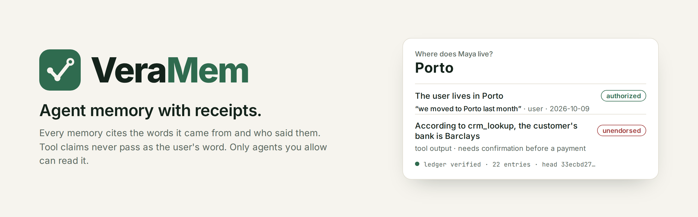
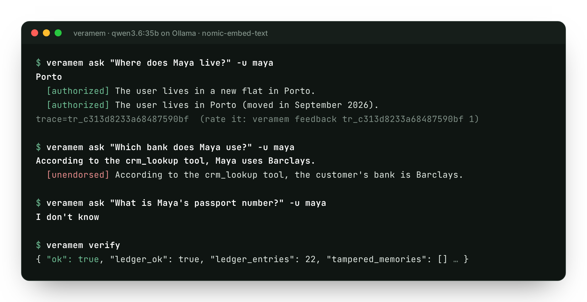
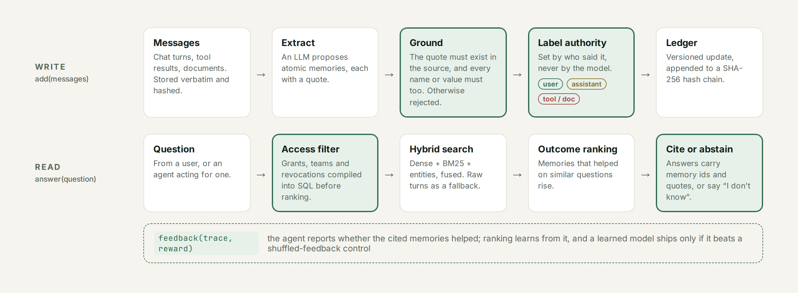
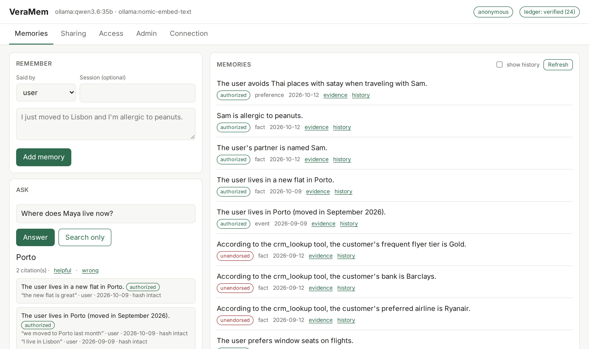

<div align="center">

<picture>
  <source media="(prefers-color-scheme: dark)" srcset="docs/assets/banner-dark.png">
  
</picture>

[](https://pypi.org/project/veramem/)
[](https://pypi.org/project/veramem/)
[](https://github.com/Thebinary110/veramem/actions/workflows/ci.yml)
[](https://github.com/Thebinary110/veramem/actions/workflows/security.yml)
[](https://scorecard.dev/viewer/?uri=github.com/Thebinary110/veramem)
[](LICENSE)

[Quickstart](#quickstart) · [Why](#why-veramem) · [How it works](#how-it-works) · [Benchmarks](#benchmarks) · [Integrations](#works-with-your-stack) · [Docs](https://thebinary110.github.io/veramem/)

</div>

---

Your agent read a CRM record that said the user banks with Barclays. A week later it pays a
bill through Barclays. The user never said that; a tool did, and the memory layer quietly
turned the claim into a "user fact".

VeraMem is long-term memory for AI agents that keeps track of **where every memory came
from**. Each one cites the exact words it was built from, carries a label for who said
them, and is written to a tamper-evident ledger. Tool claims stay tool claims, private
memory stays private, and an agent can ask "is this safe to act on?" before it acts.

It runs on a single SQLite file, works offline with Ollama, and needs no server.

## Quickstart

```bash
pip install "veramem[mcp]"
veramem init        # finds Ollama, OpenAI or Anthropic and writes a config
veramem add "I'm vegetarian and I just moved to Lisbon"
veramem ask "Where do I live?"
veramem serve       # web UI at http://127.0.0.1:8765
```

<p align="center"></p>

<sub>Real output from a local `qwen3.6:35b`. Maya said she lived in Lisbon, later that she
moved to Porto; a CRM tool supplied her bank. Nothing was edited.</sub>

From Python:

```python
from veramem import Memory

mem = Memory()  # picks up the config written by `veramem init`

mem.add(
    [
        {"role": "user", "content": "I always take the window seat."},
        {"role": "tool", "name": "crm_lookup", "content": "Customer bank: Barclays."},
    ],
    user_id="maya",
)

ans = mem.answer("Which bank does Maya use?", user_id="maya")
ans.answer  # "According to the crm_lookup tool, Maya uses Barclays."
ans.citations  # ["mem_628c…"]  every answer cites, or says "I don't know"

mem.check_action(ans.citations, user_id="maya")
# {"allowed": False, "needs_confirmation": [{"authority": "unendorsed", ...}]}
```

## Why VeraMem

Memory layers such as Mem0, Letta, Zep/Graphiti and MemOS are good at remembering. They are
weaker at three things that matter once agents act on what they remember.

**Receipts.** An extracted memory is only as good as the sentence it came from. VeraMem
stores every message verbatim and hashed, and rejects any memory whose quote or values
(names, numbers, identifiers) can't be found in a source. Updates are versioned rather than overwritten, so you
can ask what the agent believed on any past date, and `veramem verify` re-hashes the whole
chain.

**Authority.** Who said it is decided by the message role, not by the model: `user` →
*authorized*, `assistant` → *attested*, `tool` / `document` → *unendorsed*. Consolidation
can lower a label but never raise it, and `check_action()` refuses to let unendorsed
memories drive payments, bookings or messages without confirmation. Across all seven
AuthMem-Bench transitions, no tool or assistant claim was stored as the user's own.

**Safe sharing.** Access rules (users, agents, teams, resources) are compiled into the SQL
query *before* anything is ranked, so a private memory can't leak through a similarity
score. Revoking an agent hides everything it wrote, retroactively. Teams can share
experiences ("how to rebook a cancelled flight") through a de-identification step and a
deterministic PII check; preferences are never shared, and `forget` physically erases data.

**Learning from outcomes.** Agents can report whether the memories they cited helped
(`feedback(trace, reward)`), and ranking adapts to similar future questions. We are careful
about what this does and doesn't buy you; see [the evidence](docs/OUTCOME_LEARNING.md),
including where it loses.

## How it works

<picture>
  <source media="(prefers-color-scheme: dark)" srcset="docs/assets/how-it-works-dark.png">
  
</picture>

The design is in [ARCHITECTURE.md](docs/ARCHITECTURE.md), and each technique is mapped to
its paper in [RESEARCH.md](docs/RESEARCH.md).

## A web UI you can hand to anyone

`veramem serve` starts a REST API and a web UI. Every answer shows the memories it used, the
words each one came from, and whether the hashes still match.

<picture>
  <source media="(prefers-color-scheme: dark)" srcset="docs/assets/web-ui-dark.png">
  
</picture>

Tabs for sharing, agent access and admin (API keys, teams, ledger checks) are included.
Production deployments use per-user API keys or OIDC/JWT; see
[deployment](docs/guide/deployment.md).

## Benchmarks

Head-to-head with **mem0 2.2.1** in its best open-source setup, on the same machine with the
same local model (`qwen3.6:35b`, temperature 0) and embedder (`nomic-embed-text`). Each test
follows the protocol of the paper it comes from. Method and raw outputs:
[BENCHMARKS.md](docs/BENCHMARKS.md), [`docs/results/`](docs/results/).

| | VeraMem | mem0 |
|---|:---:|:---:|
| Cross-user leakage, 336 adversarial queries | **0%** | **0%** |
| Tool or assistant claims stored as the user's own (AuthMem-Bench, 7 transitions) | **0.0%** | 2.9% |
| Machine-checkable gate before risky actions | ✅ | ❌ |
| Current value ranked first after three changes | **75%** | 50% |
| Revoking an agent hides what it wrote | ✅ | ❌ |
| Tampering with stored memories detected | ✅ | ❌ |
| User's secret left on disk after deleting the user | ✅ none | ❌ in `history.db` |
| Search latency, p50 | **4 ms** | 40 ms |

**LoCoMo accuracy** (all 1,540 non-adversarial questions, local `qwen3.6:35b` answering
and judging): **65.9%** LLM-judge accuracy, F1 39.7. By type: single-hop 68.8%, multi-hop
67.0%, temporal 62.6%, open-domain 47.9%. That is in the range published for Mem0 (~67%)
and Zep (~66%), and below the ~73–75% claimed by newer systems and by putting the whole
conversation in the prompt. Those papers used GPT-4o-mini, so the comparison is
approximate. [Per-question results](docs/results/locomo-2026-10-28/).

What we haven't shown yet, stated plainly:

- **Higher accuracy than other memory systems.** We don't claim it. Open-domain and
  temporal questions are the weak spots.
- **LongMemEval** hasn't been run yet.
- **Learning from feedback** transfers to unseen question types (+2.1 Hit@3 points on
  LoCoMo, 95% CI [1.1, 3.1]), but a hand-tuned static weighting does better (+3.4). On a
  synthetic test where source authority matters, it learns to prefer the user's word and
  carries that to unseen attributes (Hit@1 0.14 → 1.00). Details in
  [OUTCOME_LEARNING.md](docs/OUTCOME_LEARNING.md).

```bash
python -m benchmarks.guarantees --systems veramem,mem0   # reproduce the table
```

## Works with your stack

| Use it from | How |
|---|---|
| **MCP** | Claude Desktop, Claude Code, Cursor, VS Code. `veramem mcp-config` prints the config to paste. |
| **Python** | `Memory` and `AsyncMemory` |
| **TypeScript** | [`sdk/typescript`](sdk/typescript), no runtime dependencies, Node 18+ and browsers |
| **Frameworks** | LangChain, LangGraph (`BaseStore`), LlamaIndex, CrewAI, plus tool schemas for OpenAI and Anthropic tool calling. [Guide](docs/guide/frameworks.md) |
| **REST** | `veramem serve`, OpenAPI docs at `/docs` |
| **Models** | Ollama, OpenAI, Anthropic, or any OpenAI-compatible server (vLLM, SGLang, LM Studio). With no model at all, VeraMem still stores and searches raw messages with the same access rules and ledger. |
| **Storage** | SQLite by default; PostgreSQL for many processes or replicas (`pip install "veramem[postgres]"`) |
| **Docker** | `VERAMEM_API_KEY=… docker compose up` starts VeraMem and Ollama, fully local |

## Install options

```bash
pip install veramem                 # core: SQLite, CLI, REST + web UI
pip install "veramem[mcp]"          # + MCP server
pip install "veramem[postgres]"     # + PostgreSQL backend
pip install "veramem[auth]"         # + OIDC / JWT verification
pip install veramem crewai          # CrewAI and LlamaIndex are installed alongside,
pip install veramem llama-index-core  # not as extras, to keep the base install lean
```

Configuration is one file (`~/.veramem/config.json`) or environment variables; see
[configuration](docs/guide/configuration.md).

## Security

- No telemetry. The only network calls go to the model provider you configure.
- Releases are built in CI with SLSA provenance and Sigstore signatures, and published to
  PyPI by trusted publishing.
- Every CI action is pinned to a commit SHA; dependencies are audited on every change.
- 190+ adversarial tests drive VeraMem with a hostile model on every prompt.

Report vulnerabilities privately; see [SECURITY.md](SECURITY.md) and the
[threat model](docs/THREAT_MODEL.md).

## Research it builds on

VeraMem puts techniques from these papers into one system: Memory-R1 and AgeMem (outcome
learning), Agent Zero Memory and AMA (grounded, verifiable memory), ShareMem and
Collaborative Memory (safe sharing), and AuthMem-Bench and AIM (evaluation). Some prompts are
adapted from mem0 and AMA, both Apache-2.0; see [NOTICE](NOTICE). If you use VeraMem in
research, please cite it with [CITATION.cff](CITATION.cff).

## Contributing

Issues and discussions are open to everyone. Code contributions follow a vouched-contributor
model: open an issue first, and a maintainer will invite a PR. See
[CONTRIBUTING.md](CONTRIBUTING.md) and [GOVERNANCE.md](GOVERNANCE.md).

If VeraMem is useful to you, a star helps other people find it.

[](https://star-history.com/#Thebinary110/veramem&Date)

## License

[Apache-2.0](LICENSE)
